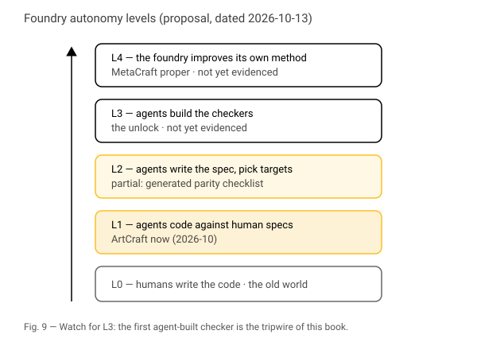

# IX. MetaCraft

**Status:** Draft v0.2 2026-10-25. Source: Gemini draft s.VI, restructured per Review E, expanded with greenfield physical tooling and local execution models.
**Revision date:** 2026-10-25.

## The craft that makes crafts

Thirteen applications in two weeks is not thirteen projects. It is one
method run thirteen times. This chapter names the method as an object of
its own: MetaCraft, the foundry that makes Crafts under agent control.

It exists because coding was the first solved craft. Once the craft of
writing software crossed into superhuman speed and consistency in 2026,
software engineering ceased to be an artisan bottleneck and became an
automated instrument of production. MetaCraft is what happens when that
solved craft is directed systematically at every other trade.

## The foundry already exists

Strip PhotoCraft's documents of their subject and what remains is a
recipe:

| Foundry part | ArtCraft instance (2026-10-11..13) | Physical / Greenfield instance (2026-10-24) |
|---|---|---|
| Specification | parity documents scored against the incumbent | STEP/URDF/OpenUSD scene graphs and constraint sets |
| Ground truth | the incumbent installed and measured (Photoshop 27.11.0) | physics engine oracles (MuJoCo, Isaac Lab) and test coupons |
| Budget | remaining work in agent wall-clock hours | GPU compute wall-clock for PPO training and FEA solvers |
| Checkers | reference implementations, command fuzzing | collision meshes, stress tensors, closed-loop vision feeds |
| Standards | shared rules across all apps (`craftrules`) | deterministic ROS 2 interfaces, headless CLI ergonomics |
| Output | about one release per app per day | containerized execution harnesses, calibrated G-code |

A human chooses the target and approves the rules. Agents do most of the
rest. The foundry is not a forecast. It is the commit log.

## Five levels

The levels below are a way of dating progress. They are a proposal, not
an industry standard.

| Level | Who does what | Evidence at 2026-10-25 |
|---|---|---|
| L0 | Humans write the code | the old world |
| L1 | Agents write code against specs and checkers made by humans | ArtCraft now |
| L2 | Agents write the specification by examining the incumbent, and choose targets from demand | partial: the parity checklist is generated |
| L3 | Agents build the checkers themselves | early evidence: automated synthetic physics test generation |
| L4 | The foundry improves its own method, rules and pipeline | not yet evidenced in public |

## Why L3 matters most

Chapters IV and VIII made one claim twice: agent synthesis scales as far
as cheap verification reaches, and the order in which incumbents fall is
set by the cost of checking a clone. Today, humans build the expensive
checkers: the corpus of files made in the real application, the
reference implementation, the physical sample.

A foundry whose agents build those checkers themselves removes the
constraint that sets the order. Below L3, the storm moves through the
industry at the pace humans can build oracles. Above it, at the pace of
compute. Watching for the first public evidence of L3 is the single most
useful thing a reader of this book can do. `[construction: define what
counts as evidence, e.g. a corpus or reference implementation committed
with no human author]`

## The test bench paradox

A swarm that writes both the product and the tests can agree with its own
mistakes. Independence needs a reference outside the swarm. In the
cloning phase that reference is the incumbent: installed, measured,
driven through the same actions as the clone, its outputs compared.

So the foundry depends on the thing it replaces. The incumbent becomes the
clone's test bench. MetaCraft is strongest where an original exists and
weakest where it must invent. What happens when the clone surpasses the
original, and must become its own reference, is open. `[construction:
Review E question 4]`

## The greenfield physical stack

The foundry does not stop at two-dimensional pixel arrays or vector path
canvases. In late October 2026, the method touched mechanical engineering
and motion control.

The proprietary incumbents here are AutoCAD, SolidWorks, Revit, and CATIA.
Their moats appeared wider than Adobe's because engineering software demands
geometric kernel math (boundary representation, NURBS surfaces, constraint
solvers) and tight integration with manufacturing hardware.

The greenfield response skips their graphical user interfaces entirely.
The stack combines three headless components:
1. **Parametric geometry kernel**: Open-source engines (FreeCAD, OpenCASCADE,
   CadQuery) driven via Python interfaces.
2. **Universal scene description**: OpenUSD stages (`pxr` API) carrying
   kinematic hierarchies, material properties, and collision geometry.
3. **Synthetic physics oracle**: Massively parallel GPU simulators (Nvidia
   Isaac Lab, MuJoCo) executing reinforcement-learning test harnesses (RSL-RL
   PPO runners) alongside deterministic ROS 2 control nodes.

In this pipeline, verification is mathematical rather than visual. The agent
does not check whether a rendered bracket looks pleasant. It applies a simulated
ten-kilonewton shear load across a finite-element mesh and measures von Mises
stress at the bolt holes. If the safety factor falls below 2.5, the harness
mutates the fillet radius and reruns the solver.

## Air-gapped execution and local sovereignty

Desktop proprietary software created a dependency structure through cloud
entitlements, license servers, and mandatory telemetric telemetry. When an
incumbent revokes a subscription, the user loses access to historical
project files.

The greenfield foundry inverts that exposure. Because the agents generate
pure code rather than binary blobs, the complete toolchain runs offline on
consumer workstation hardware: an RTX 4090 desktop running WSL2 or Linux.
No packets leave the local subnet.

This has an operational consequence that legacy vendors did not anticipate.
When a engineering workflow requires zero external API calls and depends on
no remote license managers, the toolchain becomes sovereign. An individual
developer or small workshop operating an offline foundry can produce, verify,
and output calibrated manufacturing toolpaths without external supervision
or counterparty risk.

## Where the humans remain

The sister books ask of every system where a named party can still
apply a brake. In the foundry, the attachment points are:

1. **Target choice.** Who decides what to clone next.
2. **Rule approval.** Who signs off the foundry's standards.
3. **Release signing.** Who holds the code-signing certificate (Ch VI,
   threshold D).
4. **Accountability.** Who answers a court or a regulator.

As agents gain independence, these do not disappear. They concentrate
into a few people and a few keys. A responsible history of MetaCraft
names them and dates them, rather than describing the removal of the
human from the loop. Removal is a claim about the code. Accountability is
a fact about the law, and it has not changed.

## The application does not die, yet

The Gemini draft predicted that the application would dissolve into
ephemeral software, generated on demand and discarded. The evidence of
2026 runs the other way. The foundry produces stable, versioned clones of
named products, released daily, tracked against a parity floor that only
rises. That is more application, not less.

Disposable software may come later, for problems an automated check can
verify completely. Where a process must be certified or audited (Ch VI,
threshold E), the stable application survives because the audit needs
something stable to audit. This book treats ephemeral software as a
hypothesis for a later revision of this chapter.

## Fleet link

on-ai-takeover: the same autonomy levels applied to firms rather than
applications. A company run as a foundry is the next chapter of that book.
